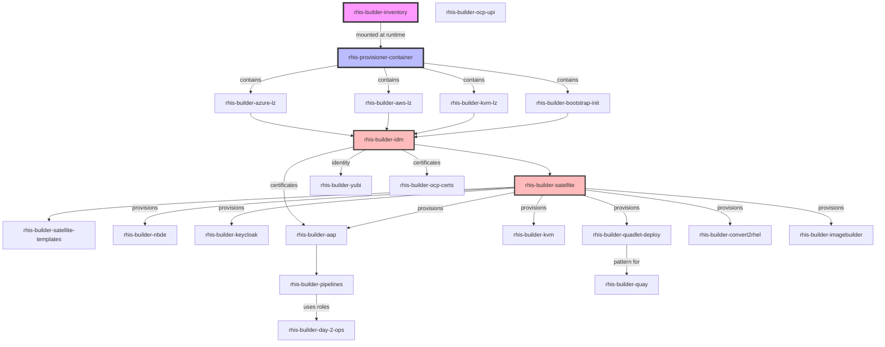

# RHIS Dependencies

**Inter-repository dependencies and relationships**

Last Updated: 2026-10-16

---

## Dependency Visualization



---

## Dependency Matrix

| Repository | Depends On | Consumed By | Deploy Order |
|------------|------------|-------------|--------------|
| **rhis-builder-inventory** | None | All repos (mounted at runtime) | N/A (data) |
| **rhis-provisioner-container** | inventory + all repos | Operators | N/A (build) |
| **rhis-builder-bootstrap-init** | inventory | idm, satellite | 1 |
| **rhis-builder-kvm-lz** | inventory | idm, satellite | 1 |
| **rhis-builder-aws-lz** | inventory | idm, satellite | 1 |
| **rhis-builder-azure-lz** | inventory | idm, satellite | 1 |
| **rhis-builder-idm** | landing zone, `redhat.rhel_idm` | satellite, aap, yubi, all services | 2 |
| **rhis-builder-satellite** | idm, `redhat.satellite` | templates, all services | 3 |
| **rhis-builder-satellite-templates** | satellite | satellite (template sync) | 3+ |
| **rhis-builder-aap** | satellite, idm, `ansible.controller` | pipelines | 4 |
| **rhis-builder-pipelines** | aap, day-2-ops, satellite | workloads | 5+ |
| **rhis-builder-nbde** | satellite, `containers.podman` | encrypted clients | 4+ |
| **rhis-builder-keycloak** | satellite, idm | applications | 4+ |
| **rhis-builder-yubi** | idm | privileged users | 4+ |
| **rhis-builder-kvm** | satellite | vm workloads | 4+ |
| **rhis-builder-quadlet-deploy** | satellite | quay, log aggregation | 4+ |
| **rhis-builder-quay** | quadlet-deploy pattern | container workflows | 4+ |
| **rhis-builder-ocp-certs** | idm | ocp-upi | 4+ |
| **rhis-builder-ocp-upi** | satellite, ocp-certs | OCP clusters | 4+ |
| **rhis-builder-convert2rhel** | satellite, aap | migrated systems | 4+ |
| **rhis-builder-imagebuilder** | satellite | custom images | 4+ |
| **rhis-builder-day-2-ops** | inventory | pipelines | 4+ |

**Deploy Order**:
- **1**: Landing zone (creates bootstrap hosts)
- **2**: IdM (identity, DNS, CA — all services depend on this)
- **3**: Satellite (content, provisioning — provisions everything after bootstrap)
- **4**: AAP and infrastructure services (provisioned via Satellite)
- **5+**: Operational automation (requires AAP + other services)

---

## Layered Architecture

The dependency graph is strictly layered — no circular dependencies exist.

```
Layer 0: Configuration
  └─ rhis-builder-inventory (data, no automation dependencies)

Layer 1: Landing Zones
  └─ bootstrap-init, kvm-lz, aws-lz, azure-lz
  └─ Creates minimal RHEL hosts for Layer 2

Layer 2: Core Infrastructure
  └─ IdM (identity, DNS, CA)
  └─ Satellite (content, provisioning)
  └─ All subsequent layers depend on both

Layer 3: Automation Platform
  └─ AAP (depends on IdM for certs, Satellite for provisioning)

Layer 4: Infrastructure Services
  └─ NBDE, Keycloak, YubiKey, KVM, Quay, OCP
  └─ All provisioned via Satellite, authenticated via IdM

Layer 5: Operational Automation
  └─ Pipelines + Day-2-Ops (run through AAP)
  └─ convert2rhel, imagebuilder (orchestrated by AAP)
```

---

## Container Build Dependencies

The provisioner container aggregates all repos at build time via
`configure_rhis_builder.yml` (an Ansible playbook using `ansible.builtin.git`).

### Build-Time

- RHEL UBI 9 or 10 base image
- 19 rhis-builder-* repos cloned into `/rhis/rhis-builder-*/`
- Ansible collections installed from Automation Hub
- Python packages from RPMs (`dnf_requirements.txt`)
- Scanning tools: Grype, Trivy, ClamAV, Syft, cosign, KICS

### Runtime

- `rhis-builder-inventory` deployment mounted at `/rhis/vars/`
- Vault secrets mounted at `/rhis/vars/vault/`
- SSH access to target hosts
- Network connectivity to IdM, Satellite, and target infrastructure

---

## Ansible Collection Dependencies

Collections are installed into the base container during build.

### Core Collections (used across most repos)

| Collection | Primary Consumer |
|-----------|-----------------|
| `ansible.builtin` | All repos |
| `ansible.posix` | All repos |
| `ansible.utils` | All repos |
| `community.general` | All repos |

### Platform Collections

| Collection | Consumer Repo |
|-----------|--------------|
| `redhat.rhel_idm` | rhis-builder-idm |
| `redhat.satellite` | rhis-builder-satellite |
| `redhat.rhel_system_roles` | Multiple repos |
| `ansible.controller` | rhis-builder-aap |
| `infra.ah_configuration` | rhis-builder-aap |
| `containers.podman` | rhis-builder-nbde, quadlet-deploy |

### Cloud Collections

| Collection | Consumer Repo |
|-----------|--------------|
| `amazon.aws` | rhis-builder-aws-lz |
| `azure.azcollection` | rhis-builder-azure-lz |

### Collection Version Policy

RHIS intentionally uses collections beyond their declared `requires_ansible`.
This is by design — the collection `requires_ansible` metadata is often
more restrictive than actual compatibility. Collection versions are pinned
in the container build, not in individual repos.

---

## IdM Integration Dependencies

IdM is the most deeply integrated dependency. Every service connects to it.

| Service | IdM Dependency | Mechanism |
|---------|---------------|-----------|
| Satellite | Client enrollment, realm integration, HTTP principal, CA certs | `ipa-client-install`, `foreman-prepare-realm` |
| AAP | TLS certificates per component (controller, gateway, hub, EDA, database) | `platform_node_pre` role requests certs via IdM |
| NBDE | Host enrollment for Tang servers | Standard IdM client |
| Keycloak | Identity federation backend | LDAP/Kerberos integration |
| YubiKey | Hardware token enrollment | Smart card auth via IdM |
| OCP | Wildcard TLS certificates | `ipa-getcert` for wildcard certs |
| KVM | Host enrollment | Standard IdM client |
| All hosts | DNS, authentication, authorization | Dynamic DNS, Kerberos, HBAC |

---

## Satellite Provisioning Dependencies

After bootstrap, all infrastructure is provisioned through Satellite.

```
Satellite provisions hosts by:
  1. Selecting a hostgroup (defines OS, partition table, config)
  2. Choosing a compute resource (where to create the host)
  3. Applying a compute profile (sizing: CPU, RAM, disk)
  4. Creating the instance
  5. Kickstarting RHEL installation
  6. Auto-enrolling in IdM realm
  7. Registering for content management
```

Deploy scripts in `/rhis/rhis-builder-pipelines/` use
`rhis_build_from_provisioner.yml` to execute this workflow for each
service type.

---

**Document Version**: 2.0
**Last Updated**: 2026-10-16
**Authors**: parmstro, Claude Opus 4.6
