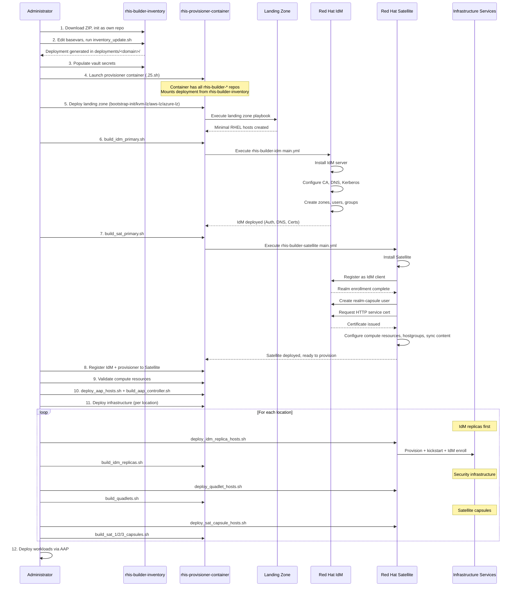

# RHIS Deployment Flow

## Complete Deployment Sequence

## Phase Breakdown

### Phase 1: Bootstrap
- Create provisioner, IdM primary, Satellite primary
- Bare metal: use `rhis-builder-bootstrap-init`
- VM/cloud: use appropriate landing zone

### Phase 2: Registration
- Register IdM primary and provisioner to Satellite
- Enables content management and patching for bootstrap hosts

### Phase 3: Validation
- Test bare metal and VM compute resource provisioning
- Verify IdM enrollment, DNS, content access
- Destroy test machines

### Phase 4: AAP
- Deploy AAP hosts via Satellite (`deploy_aap_hosts.sh`)
- Build AAP controller (`build_aap_controller.sh`)
- Post-install: job templates, credentials, EE configuration

### Phase 5: Infrastructure (per location)
- IdM replicas in local datacenter first
- Security infrastructure (NBDE Tang servers, log aggregation)
- Satellite capsules
- Additional AAP nodes

### Phase 6: Workloads
- Application deployments via AAP job templates
- Operational automation via `rhis-builder-pipelines`

## Total Deployment Time

- **Minimum** (small environment, experienced admin): 2-3 hours
- **Typical** (standard environment): 4-6 hours
- **Large** (multiple sites, many services): 1-2 days

Satellite content sync is the biggest variable — from 30 minutes on high-spec
hardware with fast networking to 10+ hours on NUC-class hardware with 1Gb
connection.

## Success Criteria

After deployment:
- IdM web UI accessible
- Satellite web UI accessible
- DNS resolution working via IdM
- Kerberos authentication functional
- Satellite can provision new hosts via all configured compute resources
- All services registered in IdM
- All services managed by Satellite
- AAP controller operational with job templates configured

---

**Document Version**: 2.0
**Last Updated**: 2026-10-16
