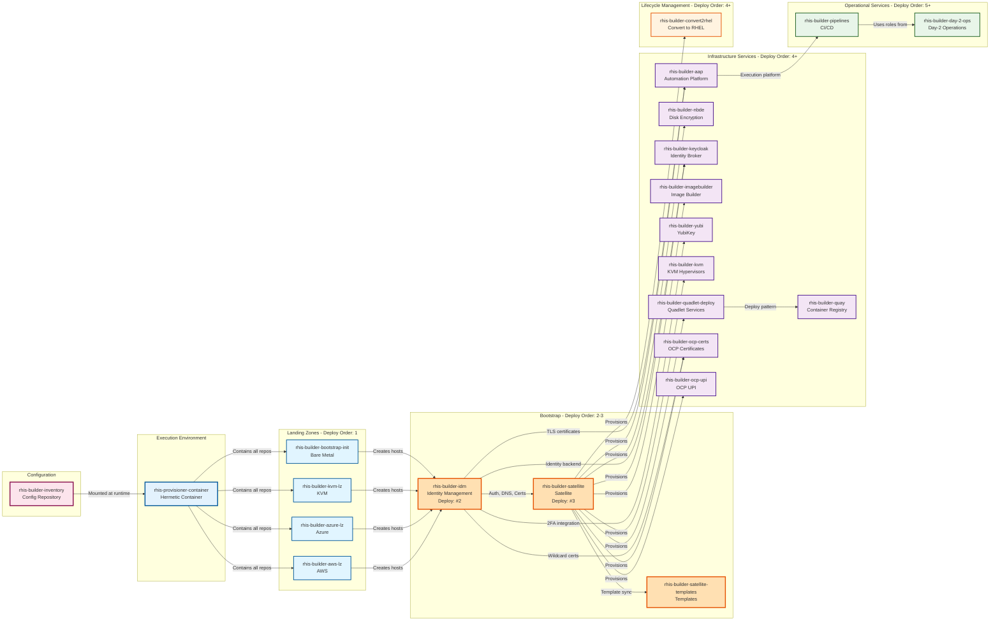

# RHIS Dependency Graph

## Repository Dependencies



## Dependency Types

### Build-Time Dependencies
- **rhis-provisioner-container** clones 19 repositories during build via
  `configure_rhis_builder.yml` (Ansible playbook using `ansible.builtin.git`)

### Runtime Dependencies
- **rhis-builder-inventory** deployment mounted into container at `/rhis/vars/`

### External Dependencies

#### Ansible Collections
```yaml
# Core
- ansible.posix
- ansible.utils
- community.general

# Red Hat
- redhat.rhel_idm
- redhat.satellite
- redhat.rhel_system_roles

# Automation
- ansible.controller
- infra.ah_configuration

# Containers
- containers.podman

# Cloud
- amazon.aws
- azure.azcollection
```

#### Red Hat Products
- Red Hat Identity Management (IdM)
- Red Hat Satellite
- Red Hat Ansible Automation Platform
- Red Hat Enterprise Linux 9.x, 10.x

## Critical Path

The critical deployment path (cannot be parallelized):

```
Landing Zone -> IdM -> Satellite -> Services
```

After Satellite is deployed, all other services can be provisioned in parallel.

---

**Document Version**: 2.0
**Last Updated**: 2026-10-16
