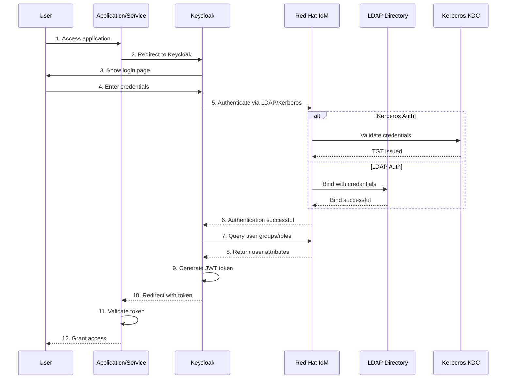
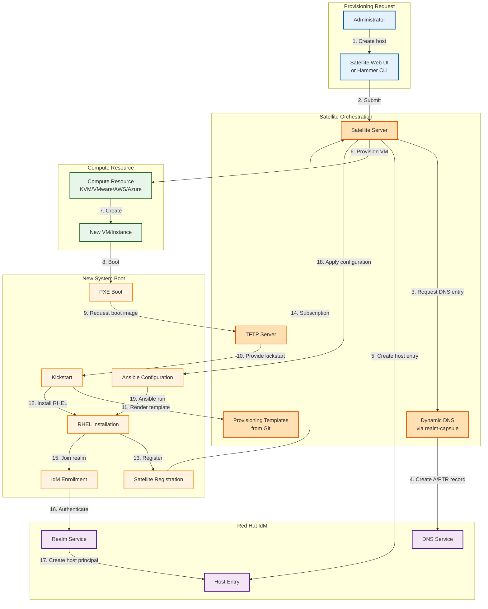
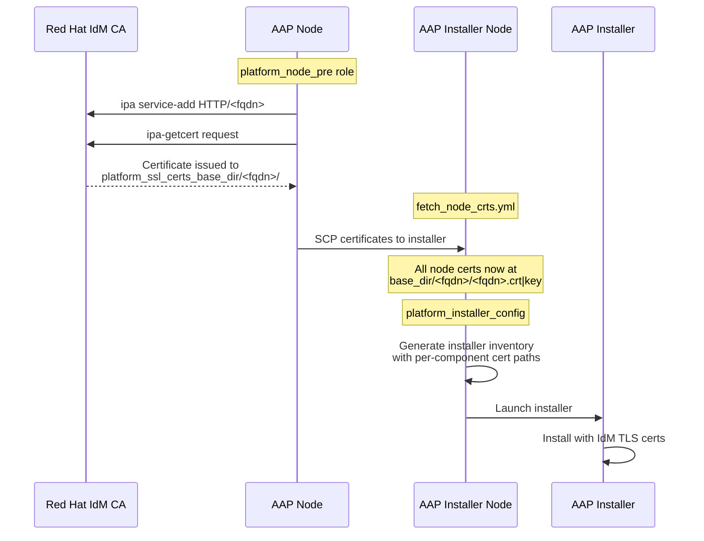
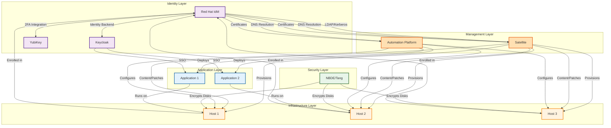

# RHIS Integration and Data Flow

## Identity and Authentication Flow



## Provisioning Flow



## AAP TLS Certificate Flow



## Service Integration Map



## Data Persistence

### Configuration Data
```
rhis-builder-inventory (Git)
  ├── inventory_template/    -> Source of truth templates
  ├── deployments/<domain>/  -> Rendered output (never edit directly)
  │   ├── host_vars/
  │   ├── group_vars/
  │   ├── inventory/
  │   ├── templates/
  │   ├── vars/
  │   ├── files/
  │   ├── external_tasks/
  │   └── vault/             -> Encrypted secrets (never regenerated)
  └── inventory_update.sh    -> Renders templates to deployments

Mounted into container at /rhis/vars/
```

### Identity Data
```
Red Hat IdM (389 Directory Server)
  ├── Users and Groups     -> LDAP directory
  ├── DNS Zones            -> BIND backend
  ├── Certificates         -> Dogtag CA
  ├── Kerberos Principals  -> KDC database
  └── Sudo Rules           -> LDAP entries

Replicated to: IdM replicas (multi-master)
Backed up via: ipa-backup
```

### Infrastructure Data
```
Red Hat Satellite (PostgreSQL)
  ├── Hosts                -> Inventory
  ├── Content Views        -> Package metadata
  ├── Activation Keys      -> Subscription data
  ├── Provisioning Config  -> Templates, profiles
  └── Reports              -> Audit logs

Backed up via: satellite-maintain backup
Content stored: /var/lib/pulp (separate volume recommended)
```

### Automation Data
```
Ansible Automation Platform (PostgreSQL)
  ├── Job Templates        -> Automation definitions
  ├── Inventories          -> Host lists (synced from Satellite)
  ├── Credentials          -> Encrypted secrets
  ├── Projects             -> Git repo references
  └── Job History          -> Execution logs
```

## Network Communication Patterns

### Management Traffic
```
Administrator -> Satellite (443/tcp)
Administrator -> IdM (443/tcp)
Administrator -> AAP (443/tcp via Gateway)
```

### Provisioning Traffic
```
New Host -> Satellite TFTP (69/udp)
New Host -> Satellite HTTP (80/tcp)
New Host -> Satellite HTTPS (443/tcp)
```

### Identity Traffic
```
Service -> IdM LDAP (389/tcp, 636/tcp)
Service -> IdM Kerberos (88/tcp, 88/udp)
Service -> IdM DNS (53/tcp, 53/udp)
```

### Automation Traffic
```
AAP -> Target Hosts SSH (22/tcp)
Satellite -> Target Hosts SSH (22/tcp)
```

### Security Traffic
```
Clevis Client -> Tang Server (8080/tcp)
```

---

**Document Version**: 2.0
**Last Updated**: 2026-10-16
